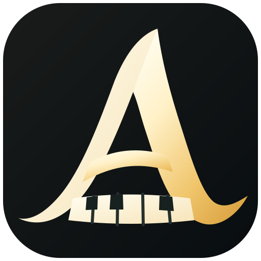
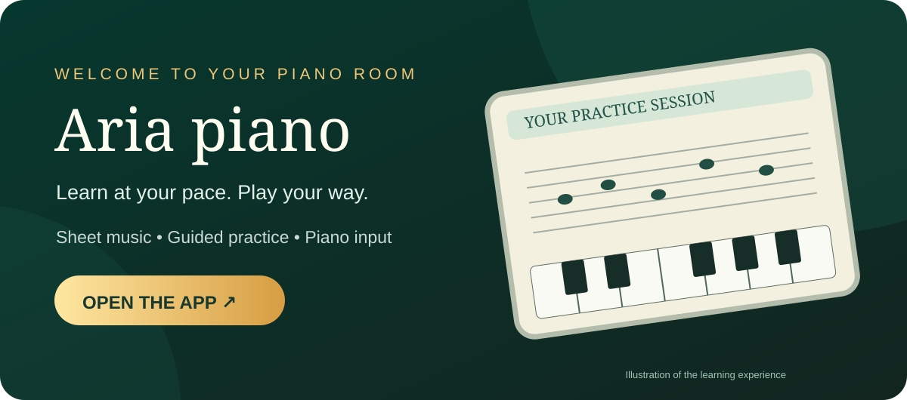
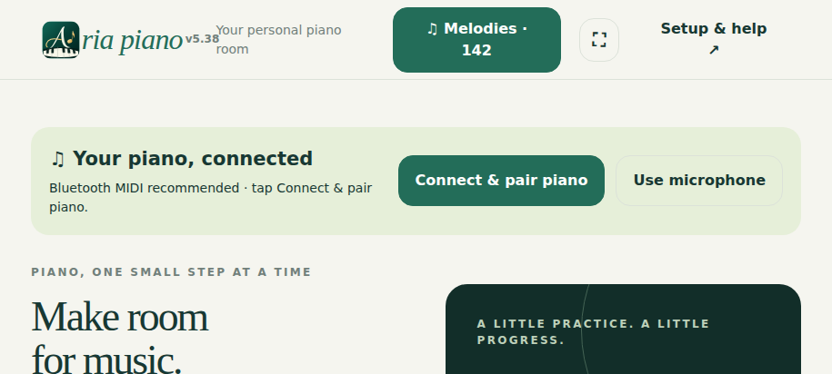
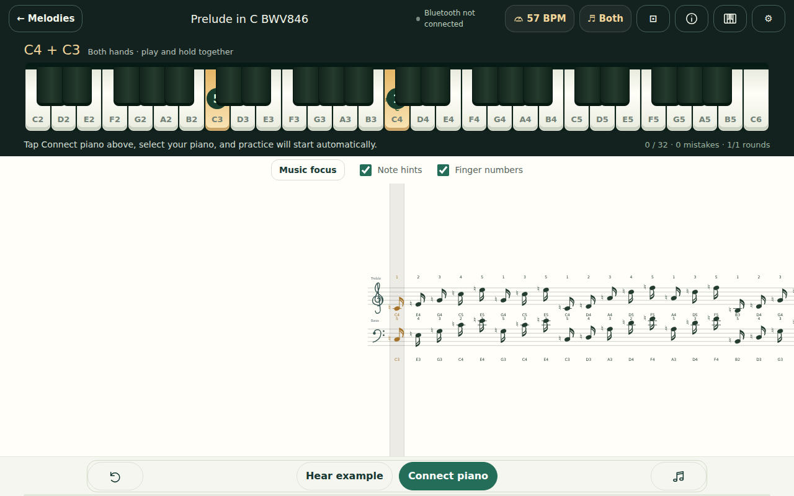
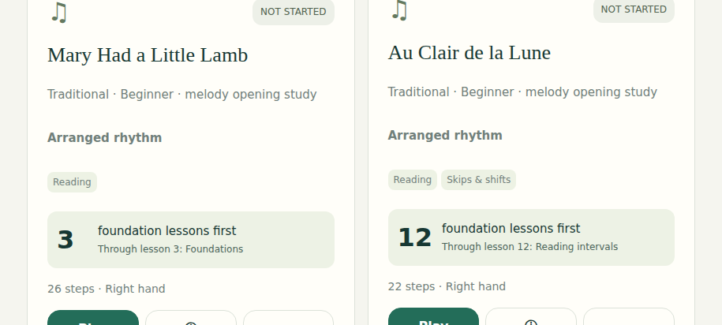
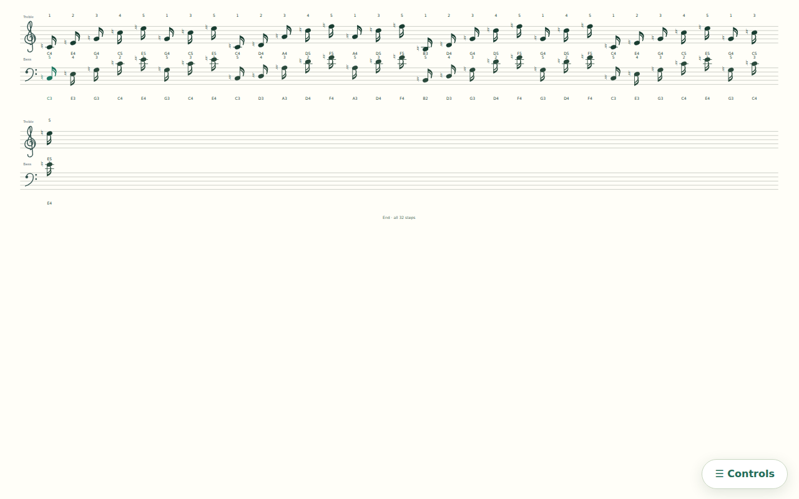

  

# Aria piano

**Your personal piano room — learn, read music, and practise at your own pace.**

### [🎹 Open Aria piano — Live app](https://fischerjooo.github.io/Aria-piano/) &nbsp; · &nbsp; [🧪 Try the beta preview](https://fischerjooo.github.io/Aria-piano/beta/)

No account required to get started. Open the app in your browser and start exploring.

## See Aria in action

Real-device-inspired screenshots are captured automatically in Chromium at phone and tablet **landscape** sizes; sheet music is captured in **landscape and portrait**.

| Phone · Welcome | Tablet · Practice |
|:--:|:--:|
|  |  |
| Phone · Melodies | Tablet · Sheet music |
|  |  |

**[Explore all 32 mobile and tablet screenshots, including portrait sheet music](docs/SCREENSHOTS.md)**

## Make time for music

Whether you're just getting comfortable with the keys or returning to piano practice, **Aria piano** brings sheet music and interactive exercises together in one place. Follow along at a pace that works for you, play on a touchscreen, or connect a supported piano and practise hands-on.

### What you can do

- **Follow sheet music.** Read notation while working through piano studies and practice material.
- **Play your way.** Use on-screen touch controls, a supported MIDI keyboard, or microphone input where your browser allows it.
- **Connect a piano.** Supported browsers can work with USB MIDI and Bluetooth MIDI instruments.
- **Pick up where you left off.** Practice progress and settings are saved locally in your browser.
- **Keep Aria close.** On supported devices, install the website as an app for quick access.

## Start playing

1. **[Launch Aria piano](https://fischerjooo.github.io/Aria-piano/)** on your phone, tablet, or computer.
2. Choose a study or piece and follow the on-screen sheet music.
3. Try the touch piano, or connect your own instrument if you prefer.
4. Return whenever you like — your progress stays on that browser and device.

**Want to preview changes?** The [beta version](https://fischerjooo.github.io/Aria-piano/beta/) offers a look at validated work in progress. It can change more often than the live app; avoid relying on beta to store your main practice progress.

## Piano connection and browser support

Aria runs in the browser. Touch input is the easiest way to try it. Microphone recognition, Web MIDI, and Bluetooth MIDI depend on your device, browser, permissions, and instrument; they are not universally supported. Bluetooth reconnection may require pairing again after a fresh launch. For best results with external MIDI hardware, use a compatible browser and a secure HTTPS connection.

For an app-like experience, use your browser's **Install app** or **Add to Home screen** option if available. On some Android browsers, installing the live and beta versions from the same GitHub Pages hostname may conflict; the beta link is best treated as a browser preview.

## Explore more

The app is open source. You can browse the [source code](https://github.com/fischerjooo/Aria-piano), [report a problem or suggest an improvement](https://github.com/fischerjooo/Aria-piano/issues), and read the [technical/developer guide](docs/DEVELOPMENT.md) if you want to build or contribute.

Application code is available under the [MIT license](LICENSE). Individual musical works and editions can have separate licensing and attribution requirements; see the source files for details.

---

<strong>Ready to play?</strong> <a href="https://fischerjooo.github.io/Aria-piano/">Open Aria piano →</a>

