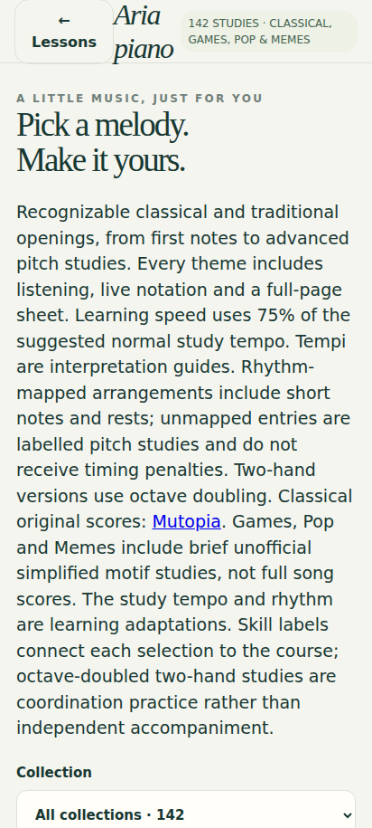
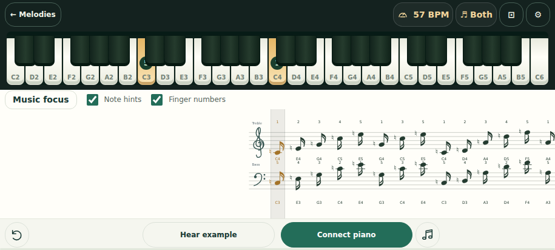
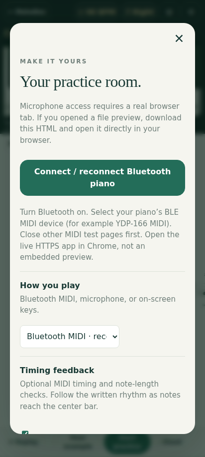
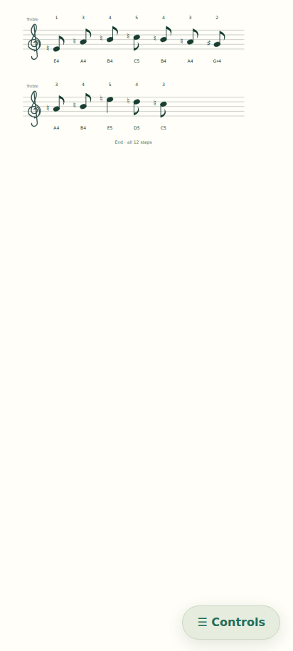
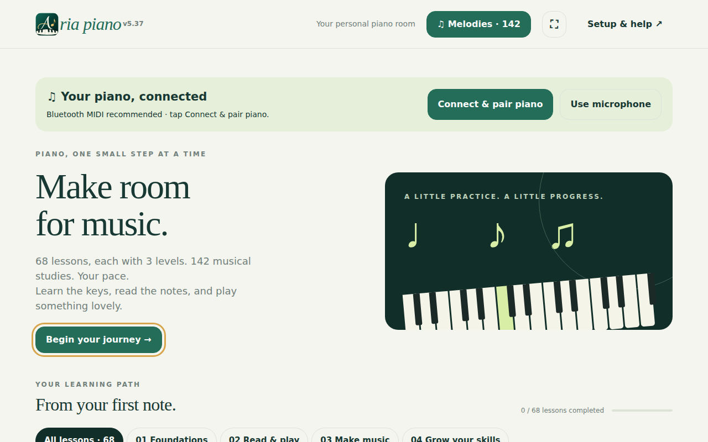
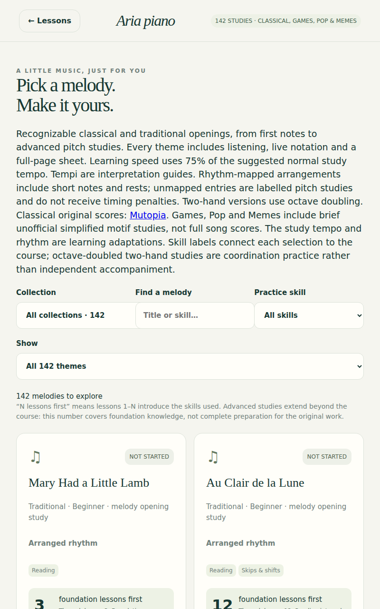
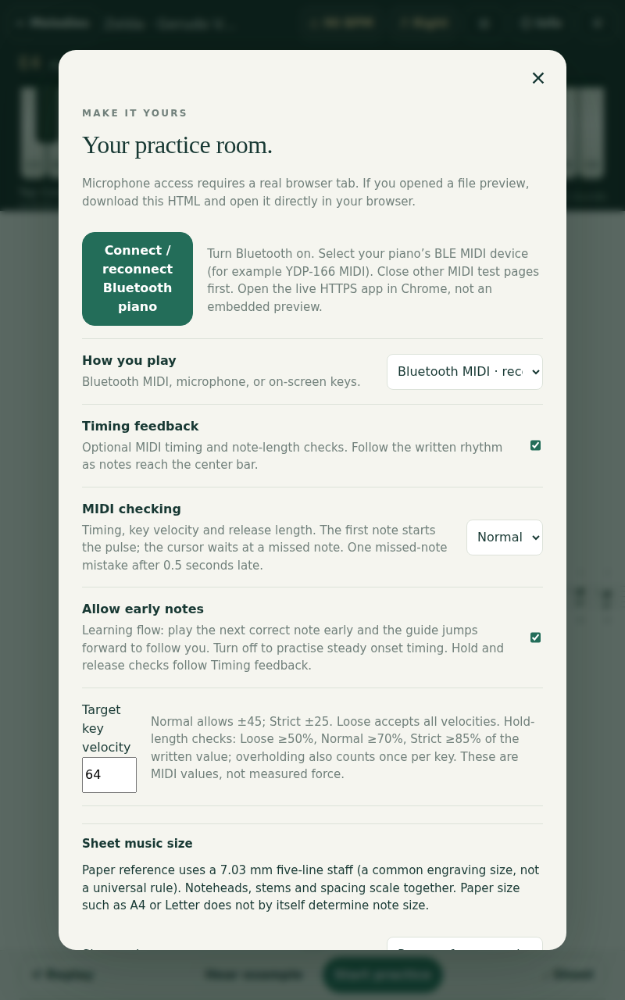
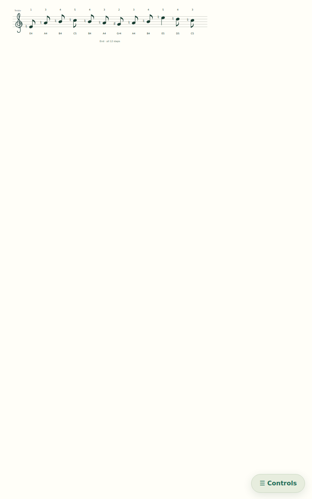

# Aria piano — screenshots

[← Back to the introduction](../README.md) · [Open live app](https://fischerjooo.github.io/Aria-piano/) · [Beta preview](https://fischerjooo.github.io/Aria-piano/beta/)

These are **actual Chromium captures of the release build**, not illustrations. The release workflow refreshes them automatically, after the UI tests pass and before publishing.

The phone profile is **412 × 915 CSS pixels**, approximating a 6.5-inch portrait phone. The tablet profile is **800 × 1280 CSS pixels**, approximating a 10-inch portrait tablet. Exact physical screen size depends on the device's pixel density.

## Phone — portrait

### Welcome and learning path

### Choose a melody or lesson

### Active piano practice

### Practice configuration

### Full-page sheet music

## Tablet — portrait

### Welcome and learning path

### Choose a melody or lesson

### Active piano practice

### Practice configuration

### Full-page sheet music

Screenshots document the responsive UI. MIDI, microphone permission dialogs, Bluetooth pairing and actual audio response require physical device testing.
